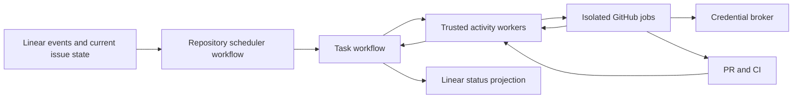

# Durable remote development rebuild

Date: 2026-10-30.

Status: agreed direction; implementation and live acceptance are outstanding.

Repository baseline: `bffbb25`.

## Objective and operating constraint

Replace Clusterfork's custom distributed task orchestration with managed durable
workflows. Make task ownership, recovery, deployment compatibility, and user-visible
status explicit while preserving isolated execution and credential safeguards.

The owner intends to halt cloud execution until this rebuild is implemented. This
document does not assert that the halt has already been applied. Verify the actual
operational state before any live work. Committing this plan, passing CI, deploying
code, or receiving a healthy response must not resume production execution.
Acceptance testing uses an explicitly scoped disposable environment. After phases
0–3 pass, an operator may admit the controlled production pilot in phase 4. Keep
the general backlog halted until cutover is verified; its resume is a separate
operator action.

This is a plan, not documentation of shipped behavior. Current behavior remains
documented in [docs/README.md](docs/README.md). Update each owning topic as changes
ship; do not copy this plan into several documentation files.

## Why rebuild

Task progress is currently inferred and mutated across readiness, repository
admission, worker records, lifecycle synchronization, repair, deployment control,
GitHub, and Linear reporting. Each part has useful safeguards, but together they
implement a distributed workflow engine whose ownership is difficult to follow.

The composite-action cleanup failure demonstrated the consequence: GitHub could
fail before the reviewer started while the stored attempt and Linear still looked
like a running reviewer. The cleanup fix (`22e265c`) and subsequent deployment
cutover fix (`bffbb25`, KIAN-932) address specific defects. They do not establish
one authority for the whole lifecycle or separate merges from runtime promotion.

The Cursor profile-staging regression is also a scope and behavior problem. It
needs a shared provider contract; a durable workflow engine alone cannot fix it.

## Architectural decision

Use **Temporal Cloud** for durable orchestration, with trusted Python workflow and
activity workers hosted in Azure. Keep fresh GitHub-hosted VMs for account preflight
and agent execution. Keep the credential broker and useful provider/runtime code;
replace the competing lifecycle writers rather than wrapping them in another layer.

Temporal Cloud stores and coordinates durable execution. Our hosted workers still
execute application code. Choose the smallest supported long-running Azure host
for those trusted workers during the implementation spike. Self-hosted Temporal,
Kubernetes, and replacing the GitHub coding sandbox are outside this rebuild.

| Alternative | Decision |
| --- | --- |
| Consolidate the current Functions/Table orchestration | Insufficient: leaves custom scheduling, recovery, and deployment coordination to maintain. |
| One controller with PostgreSQL | Simpler transactions, but still requires a custom durable execution engine. |
| Azure Durable Functions | Credible Azure-native alternative; retain as a fallback if the Temporal spike exposes a concrete blocker. |
| Temporal Cloud | Selected for durable histories, timers, recovery, and explicit worker-version routing. |

The trade-off is a managed-service bill, hosting trusted workers, and learning
deterministic replay and versioning. Measure expected usage and record a cost
budget before production provisioning; do not assume polling or retained history
is free. Revisit the choice only for a demonstrated technical or operational blocker.

## Ownership and interface

| Module | Owns | Must not own |
| --- | --- | --- |
| Repository scheduler | Eligibility, priority/order, the active task grant, and verified slot release | Worker results, account credentials, or independent interpretations of task completion |
| Task workflow | Durable phase, attempt history, timers, retry decisions, cancellation, and task outcome | Raw credentials or a second account-lease store |
| Credential broker | Authenticated worker authorization, account leases/fencing, scoped token issuance | Another scheduler or repair policy |
| Execution adapter | Dispatch/discovery, authenticated observations, isolated execution, publication receipts | Permission to start a replacement task on its own |
| Linear projection | Converging issue status, owned labels, and one current status comment from task state | Inferring lifecycle independently from GitHub or triggering execution on reporting failure |

Expose a small task interface: `submit(request)`, `observe(evidence)`,
`command(task_id, command)`, and `inspect(task_id)`. Names are illustrative; the
contract is required. Callers must not need to coordinate readiness rows, queue
rows, retry rows, and comments themselves. Tests exercise this same interface.

Ingress authenticates and validates events before submitting evidence. Repeated
submissions use stable workflow identities. Temporal workflow code is deterministic;
network calls and other side effects happen in activities behind explicit adapters.
Use durable timers and signals, plus bounded reconciliation for missed events.
Avoid introducing a second polling engine that independently advances tasks.

Define these identities before coding: repository, task generation, attempt,
external effect, scheduler grant/epoch, runtime release, and policy revision.
A GitHub attempt is a run ID plus its attempt number. Human resubmission is an
explicit generation decision; duplicate webhooks do not create new generations.

## Required lifecycle guarantees

1. **One effective task per repository.** The scheduler retains ownership through
   review, execution, publication, CI, and merge resolution. A callback, expired
   lease, or failed orchestration process does not prove that a runner stopped.
   Release requires verified task-specific stop and publication conditions. Do not
   release in an unconditional `finally` block.
2. **One authoritative task history.** Separate task outcome, agent result,
   GitHub job result, and PR/CI state. A successful publication followed by failed
   cleanup retains its PR. A failed GitHub job cannot remain an unqualified
   "running reviewer" after its terminal state is observed.
3. **Explicit uncertainty.** Persist intent before each external mutation. Record
   accepted, rejected, or unknown outcomes. An accepted dispatch with a lost
   response is discovered using its stable identity; it is never blindly resent.
   Startup fencing prevents duplicate deliveries from becoming duplicate workers.
4. **Recover publication.** Reuse deterministic branch/PR identities and verify
   existing results before any retry. Temporal activities may execute more than
   once; durable execution does not make external effects exactly once.
5. **Bound retries by cause.** Retry transient observations safely. Retry execution
   only after previous attempts are proven stopped and the relevant authorization
   still holds. Use explicit budgets for infrastructure retries, provider waits,
   and coding repair. Repeated deterministic release failures open a circuit
   breaker for affected admissions and produce an actionable hold.
6. **Preserve authorization.** Keep current eligibility, dependency, readiness,
   issue-change, repository-context, and publication guards. Snapshot policy and
   runtime versions separately from the target repository commit. Ordinary policy
   rollout does not silently rewrite an existing task's history or approval.
7. **Cancellation is a process.** Record cancellation, stop external work, reconcile
   its final state, and resolve any PR before releasing ownership. A cancellation
   acknowledgement alone does not prove cleanup or stop completion.
8. **Pauses have independent owners.** Operator halt, deployment drain, and automatic
   failure holds are distinct durable controls. Clearing a deployment's own hold
   cannot clear an operator halt. Holds survive restarts and have visible reasons;
   elapsed time or a health response never grants resume authority.

Normal task progression is eligibility/queue → readiness → account selection →
execution → validation/publication → CI/merge resolution → completion. Waiting,
clarification, cancellation, failure, and uncertain dispatch are explicit states
with evidence and recovery rules, rather than generic retries of the entire chain.
Keep durable waits outside GitHub jobs so idle runners do not consume capacity.

## Credentials, providers, and execution

- Preserve the separate ephemeral preflight and coding VMs. Pool inspection belongs
  only to authenticated preflight; coding receives only its assigned account.
- Preserve fenced credential updates, lease-loss handling, scoped GitHub tokens,
  sandbox validation, and the publication credential guard. An account lease is
  not proof of repository admission or proof that another runner has stopped.
- Keep secrets, OAuth caches, private keys, and raw transcripts out of Temporal
  history, search attributes, logs, and artifacts. Persist only necessary IDs,
  hashes, bounded sanitized decisions, and references to protected larger inputs.
- Bind runner access to authenticated GitHub/OIDC identity, the approved runtime
  release, target repository, grant, task, and attempt. Request fields cannot
  grant a role or choose an arbitrary repository. A central runtime workflow must
  preserve these checks if its repository differs from the target repository.
- Keep runtime files separate from the target checkout for the complete job,
  including composite-action post-job cleanup. Repository cleanup must not remove
  runtime actions or execute a target repository's replacement worker implementation.
- Use one enrollment/list/reserve/reclaim contract for Codex and Cursor. Reserved
  profiles remain visible in their normal location. Normal reservation does not
  require moving credentials, staging, a validation probe, or a new unblock step.
  Provider adapters contain actual authentication, CLI, quota, and execution differences.
- Preserve current narrowly authorized account failover semantics. Do not turn
  generic rate limits, auth failures, or infrastructure retries into permission to
  change accounts or transfer sessions between providers.

Detailed current safeguards are owned by
[accounts](docs/remote-development-accounts.md),
[runtime](docs/remote-development.md), and
[repository queues](docs/remote-development-queue.md). Characterize them before
replacement so the rebuild does not quietly drop behavior or broaden authority.

## Release and deployment model

Separate source merge, artifact build, verification, promotion, and task admission.
CI on a merge may build a candidate; it must not automatically replace production
execution machinery or run infrastructure reconciliation for unrelated changes.

An immutable release manifest identifies the controller implementation, broker
compatibility, runner bundle and reusable workflow revisions, provider CLI pins,
wire-protocol/schema version, and policy revision. Bind workflow references to
verified commits; do not assume the workflow-dispatch API accepts an arbitrary
SHA as its `ref`. Where dispatch uses a protected tag, verify its resolved commit.

New task workflows use the promoted compatible release. Existing tasks retain
their version and supporting workers until finished or explicitly migrated using
a tested procedure. Retain old broker compatibility while those tasks drain.
Keep the repository scheduler's long-lived versioning/history rollover deliberate;
it must not pin all future tasks to its original release accidentally.

Test the exact candidate artifacts before promotion. A health response from one
new process is not proof that all old instances disappeared. Old/new overlap must
be safe by construction. Rollback changes new-task admission and release routing;
it cannot undo PRs, merges, or other effects that already occurred.

## Status and operator recovery

Maintain one stable current-status comment per issue. Derive its phase, latest
meaningful progress, run/PR links, hold reason, and next action from authoritative
task state. Preserve separate substantive review feedback and human replies;
supersede obsolete waiting notices instead of generating another one every retry.
Projection failure is reporting debt, not execution failure or permission to rerun.

Provide an authenticated local/operator interface for `inspect`, `pause`,
`reconcile`, `retry`, and `resume`, independent of an agent processing a Linear
issue. Include bounded diagnostics, evidence freshness, and an audit of mutations.
Do not require table edits, fabricated callbacks, or manual approval-bit changes.
Retry still requires verified stop/publication state and valid authorization.
If the durable engine is unavailable, retain safe holds and report stale evidence;
do not invent a bypass scheduler.

Set explicit observation deadlines and freshness rules. Initial acceptance target:
with healthy integrations, a terminal GitHub result appears in task state and the
current Linear status within two minutes. Outages must show unavailable/stale
evidence; they must not be presented as confirmed ongoing work. Measure API calls,
Temporal actions, and idle behavior before choosing final reconciliation intervals.

## Verification and release gates

Keep useful security and provider tests. Replace duplicated lifecycle mocks with
tests through the task interface and real Temporal workflow/replay tests. Use
deterministic fake adapters for faults, then contract tests for real integrations.
A passing mock suite is insufficient for promotion.

| Injected event or failure | Required result |
| --- | --- |
| Controller/activity process dies before or after an effect | Durable recovery preserves intent and reconciles the effect without duplicate work. |
| GitHub accepts dispatch but its response is lost | Discover the existing run; keep the repository held while evidence is incomplete. |
| Duplicate webhook, callback, or manual job rerun | Stable identities and grants admit at most one effective worker. |
| Old attempt reports after a newer attempt exists | Preserve current ownership; stale evidence cannot authorize or overwrite current work. |
| Preflight succeeds but coding never starts | Observe the terminal job, explain the actual failure, and apply only the bounded startup policy. |
| Runner dies without its finish callback | Recover from GitHub and publication evidence; do not leave an unqualified running state. |
| PR is published, then cleanup or outcome persistence fails | Recover that PR; do not publish another or discard the successful effect. |
| Deployment overlaps a task or an old broker remains alive | Compatible version routing preserves task execution and prevents unauthorized starts. |
| Issue, dependency, or target context changes | Apply the documented authorization/invalidation rules at the required checkpoints. |
| Account lease is lost, quota exhausted, or credentials invalid | Stop or wait according to the explicit cause; preserve fencing and provider isolation. |
| Linear reporting is unavailable or a stale write lands late | Retain authoritative task state and converge the same projection after recovery. |
| Operator halts, then code is deployed or a resume event repeats | Operator halt remains effective until the corresponding operator resume. |
| Operator cancels during dispatch, coding, or publication | Verify all external attempts and PR disposition before releasing repository ownership. |
| Identical runtime defect repeats | Open the release circuit breaker and report the recovery action instead of looping forever. |
| Cursor or Codex is reserved and reclaimed | The same local visibility and ownership contract holds for both providers. |

A disposable live task must exercise actual webhook ingestion, scheduling,
readiness, separate account preflight, agent execution, validation, PR creation,
required CI/merge behavior, credential release, and GitHub post-job cleanup. Run
representative failure cases on the same candidate release. Use ordinary guarded
execution paths; do not create a privileged canary-only path. Bound provider use
and keep test repositories, issues, accounts, and artifacts explicitly scoped.

## Implementation sequence

### 0. Establish the halt and baseline

- [ ] Verify the owner's operational halt and identify any running/queued jobs,
  unresolved dispatches, open PRs, and occupied accounts without changing credentials.
- [ ] Ensure routine pushes/deployments cannot clear that halt. Record how current
  tasks will finish or be safely canceled before cutover.
- [ ] Inventory current lifecycle writers, safeguards, policies, and external-effect
  identities; capture redacted incident fixtures and retained data references.

Exit: production admission is verifiably held, existing work is accounted for, and
the behavior to preserve is explicit. This planning commit alone does not pass this gate.

### 1. Prove the durable workflow design

- [ ] Pin the Python SDK and supported worker-versioning configuration; choose the
  trusted worker host and record permissions, deployment configuration, and budget.
- [ ] Implement the repository scheduler/task workflow interface in a local or
  isolated development environment with real Temporal execution.
- [ ] Prove restart/replay, durable waits, duplicate submissions, grant handoff,
  cancellation, version coexistence, and bounded history rollover.
- [ ] Define typed observations, effect identities, retry classes, and release/policy
  schemas. Keep external I/O out of workflow code.

Exit: the core lifecycle survives injected process failures without relying on
the old lifecycle writers or multiple independent interpretations of task state.

### 2. Integrate execution and preserve safeguards

- [ ] Adapt GitHub dispatch/discovery, the broker, provider selection, readiness,
  execution, publication, and steering to the new task interface.
- [ ] Implement stable dispatch/publication recovery and enforce grants at worker
  startup, account access, and publication.
- [ ] Preserve existing provider/security behavior with characterization and
  contract tests, including Codex/Cursor reservation parity.
- [ ] Implement the single Linear projection and operator commands.

Exit: one isolated task completes through real adapters and every authority has
one owner. No legacy scheduler or reconciler concurrently controls that task.

### 3. Build release promotion and prove recovery

- [ ] Separate merge/build from production promotion and infrastructure changes.
- [ ] Implement immutable release manifests, compatible worker/broker routing,
  independent hold ownership, release circuit breaking, and rollback controls.
- [ ] Run the failure matrix, replay compatibility tests, and complete live canary
  on exact candidate artifacts, including post-job cleanup and terminal status repair.
- [ ] Record sanitized evidence: release IDs, test results, run/PR links, recovery
  times, API/action usage, and remaining limitations.

Exit: the release gate demonstrates a complete hosted lifecycle and recovery from
representative faults; an operator can diagnose and recover it without an agent issue.

### 4. Cut over Clusterfork and retire the old engine

- [ ] Drain or safely cancel old work; verify all recorded and discoverable attempts
  stopped and resolve PR ownership before transferring a repository.
- [ ] Import only necessary pending intent and durable references. Preserve queue
  order, completed generations, credentials, and unresolved publication identity.
  Do not reinterpret an unknown old dispatch as permission to start new work.
- [ ] Disable old admission/reconciliation writers before enabling the new owner.
  Never run both engines as active writers for the same repository.
- [ ] After phases 0–3 pass, explicitly admit one controlled Clusterfork pilot
  while keeping its general backlog halted. Verify the result and retain an
  audited route to halt and reconcile during rollback.
- [ ] Remove superseded timers, tables/writers, workflows, and retry/reporting paths
  after verifying no active references remain. Retain necessary audit history;
  account/credential storage is not obsolete orchestration data.
- [ ] Update each owning documentation topic and operating instructions to match
  shipped behavior, then mark this plan complete with verification evidence.

After the cutover gate passes, the operator can explicitly resume the backlog.
Routine deployments cannot perform this action on the operator's behalf.

Exit: one production lifecycle authority, a tested release process, working
operator recovery, and no legacy orchestration running beside the replacement.

## Completion criteria

The rebuild is complete only when all phase gates pass, every failure-matrix row
has recorded test evidence, the candidate completes a real disposable task, and
the controlled production pilot passes. Production resume must preserve any other
active operator holds. Do not declare success from unit-test counts, a deployment
success, one health response, or a worker's finish callback alone.

## Design references

- [Temporal worker hosting and deployment](https://docs.temporal.io/production-deployment/worker-deployments)
- [Temporal worker versioning](https://docs.temporal.io/production-deployment/worker-deployments/worker-versioning)
- [Temporal activity retry and idempotency semantics](https://github.com/temporalio/documentation/blob/main/docs/encyclopedia/activities/activity-definition.mdx)
- [Azure Durable Functions overview](https://learn.microsoft.com/en-us/azure/durable-task/durable-functions/durable-functions-overview)

Verify current SDK/platform support during the implementation spike. These links
support the design direction; they are not evidence that this rebuild is deployed.
