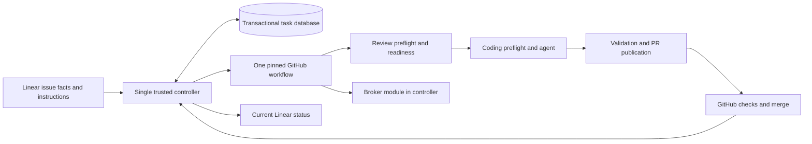

# Preventing defects in remote development

Date: 2026-10-30.

Status: replacement proposal. Supersedes the Temporal-based plan in Git history.
Implementation remains paused; writing this plan does not authorize production
resume or assert that a cloud execution halt has been verified.

## Goal

Prevent avoidable automation defects by removing their causes: competing state
owners, runtime changes during execution, invalid configuration, provider-specific
ownership rules, and releases tested in an environment unlike production.

Literal zero crashes or failures cannot be guaranteed for a system that depends
on Azure, GitHub, Linear, operating systems, networks, and model providers. This
plan targets specific defect classes we can eliminate or check before production.
It does not claim that tests prove all software correct, relabel failures as
successful waits, or count a system that never starts work as reliable.

The main deliverable is a smaller, constrained execution system with evidence for
its safety properties. A retry engine, managed workflow platform, or large recovery
framework is not the architectural centerpiece. No Temporal account is required.
The earlier request for Temporal Cloud configuration is obsolete under this proposal.

## Design decision

Use **one trusted controller, one transactional task database, and one immutable
GitHub workflow per normal task attempt**. Keep the isolated GitHub runners and
existing Azure credential storage. Use GitHub's job graph to order execution;
keep admission and authorization in one controller.

The controller runs as one supervised Python application on a small Azure VM.
Its SQLite task database lives on a managed persistent disk attached to that host,
not temporary storage, a shared filesystem, or a competing replica. The broker is
a module of the same application. TLS ingress does not make task decisions.
Only one application process owns task-state mutations; multiple repositories can
still have independent active tasks. Slow external I/O must not block credential
heartbeats or hold a database transaction open.

Constrain infrastructure to one authorized controller VM identity and exclusive
disk attachment. A local database/process lock excludes competing local writers;
it does not exclude a cloned VM with copied data or credentials. Deployment checks
must also enforce the authorized host and remove a replaced host's authority.

This is a deliberate trade: scheduled maintenance and a single controller host
in exchange for avoiding distributed lifecycle writers and overlapping runtime
versions. A VM introduces OS, disk, and backup administration. Validate those
obligations and cost during the prototype before provisioning production. Do not
quietly add autoscaling replicas, distributed leader election, or another database
service if the single-host assumptions do not fit; revisit the design explicitly.

### Alternatives considered

1. **Single controller and database:** strongest locality for admission, policy,
   and atomic ownership. Its interface hides the coordination currently spread
   across several modules. Host availability remains an explicit limitation.
2. **GitHub-only orchestration:** a native job graph removes execution handoffs,
   but Actions alone does not implement Linear priority/manual ordering,
   dependencies, shared account ownership, or repository ownership through an
   unresolved PR. Encoding those in labels/artifacts would recreate a scheduler.
3. **One transition module inside Azure Functions:** improves logical ownership,
   but scale-out handlers and partitioned Tables still require distributed write
   fencing and cross-record coordination. This retains complexity we can remove
   at the current scale.

Choose the first design with the second design's native execution graph. This
keeps one admission interface and removes the separate review-to-coding dispatch.
GitHub concurrency is a secondary guard, not the application queue: even its
larger queue has a finite limit and does not implement our admission policy.



## Prevent defects by construction

| Cause in the current design | Structural prevention | Evidence required before release |
| --- | --- | --- |
| Queue, readiness, lifecycle sync, and repair independently interpret task state | One mutation interface and one transition implementation; other modules submit facts or render views | Dependency/import checks plus tests that every mutation passes through that interface |
| State updates span independently committed lifecycle records | One local transaction owns task, repository grant, attempt identity, and action intent | Real SQLite constraint and transaction tests, including competing requests |
| Readiness completion triggers another distributed dispatch decision | One GitHub run with explicit job dependencies | Hosted test proving coding cannot start without the valid readiness result |
| Every main push changes the live control plane | Source merge builds a candidate; promotion is separate and explicit | A main-branch test proving no automatic deployment or resume is triggered |
| Old and new runtime instances overlap | Full-drain runtime upgrades with one stopped old process before replacement | Tests for exclusive local ownership, authorized host identity, and deployment exclusion within the supported topology |
| Target checkout operations remove or replace runtime files | Immutable runtime directory outside the agent's writable target tree, retained through cleanup | Actual hosted setup, execution, git-clean, and post-job cleanup tests |
| Prompt edits become wire-protocol incompatibilities | Separate wire schema, policy revision, runtime release, and target commit | Compatibility tests for each declared change category |
| Cursor develops a second account ownership lifecycle | One provider-neutral reservation/list/reclaim module | The same behavioral contract suite runs against both providers |
| Mock tests pass while actual Actions setup is broken | Promote the exact artifact exercised on real runners | Release evidence includes the complete hosted run, including cleanup |
| Status reporting changes execution decisions | Status is derived from committed task state and verified job/PR facts | A reporting outage cannot grant execution, overwrite results, or create another attempt |

## One small decision interface

Expose two entry points for callers:

```python
apply(command: Command) -> TaskView
inspect(task_id: TaskId) -> TaskView
```

`Command` is a validated, authenticated union of issue observations, runner/PR
observations, permitted worker requests, and operator commands. Callers cannot set
arbitrary phases or grant themselves a role. Repeated delivery retains the same
identity; a late observation includes its actual task, run, and attempt identity.

Inside the module, a pure function maps a committed snapshot and typed command to
an allowed transition and narrowly described effects. It performs no network I/O,
loads no mutable configuration, and reads no ambient time. Time and external facts
arrive as validated inputs. External adapters execute effects outside transactions.

Use immutable typed records, tagged states, exhaustive handling, strict static
type checks, and versioned validation at transport seams. Unknown fields, values,
and unsupported combinations produce explicit results at ingress. Avoid loose
state dictionaries with independently combinable flags.

The database enforces foreign keys, valid state values, unique task generations,
one current repository grant, and unique external-effect identities. Existing
account leases remain broker-owned resource state; do not create a second copy in
the task database. Credentials never enter the task history or status projection.
SQLite does not transact atomically with Azure account leases. Keep that resource
seam explicit: verify the current task/phase grant before new claims and token
issuance, preserve fenced credential saves/releases, and never treat a lease as
task admission. Account storage cannot independently advance the task lifecycle.

This is a fixed application lifecycle, not an extensible workflow language.
Do not introduce arbitrary step graphs, plugin-defined phases, generic retries,
multiple scheduling loops, or background modules that independently advance work.

## A task is a validated specification

Before dispatch, construct a typed task specification containing the issue and
content revision, target repository/base commit, runtime release, policy revision,
permitted provider/model configuration, validation commands, publication scope,
and execution budget. It contains references and hashes rather than credentials.
Validate project configuration when registering a project and building a release.

Readiness produces a validated proof for that specification. Coding and publication
check that proof and current authorization at their required checkpoints. A job
output or agent statement alone cannot authorize work. Material issue/context
changes follow one explicit invalidation rule owned by the transition module.
Steering stays a separately authorized instruction stream; freezing a specification
does not silently disable live instructions.

GitHub owns job execution facts. The controller stores their identities and latest
verified observations; it does not maintain another independently advancing job
engine. Distinguish orchestration phase, agent result, job conclusion, and PR state.
Completion requires the applicable verified merge or validated no-change outcome.
An agent saying it finished is insufficient. A failed check remains a real failure
in the record and metrics, even if the controller handles its result correctly.

## One native execution graph

The normal task attempt uses one pinned workflow with explicit dependencies:

1. Review account preflight on its own fresh VM.
2. Read-only readiness on another VM with only its assigned account.
3. Coding account preflight on its own fresh VM after a passing review.
4. Coding, configured validation, and guarded publication on another VM with only
   its assigned account.

GitHub orders these jobs. The broker independently verifies the readiness proof,
current repository grant, signed workflow role, run/attempt, and runtime identity.
Manual reruns cannot inherit the wrong attempt's account assignment or skip a
required authorization check.

Account bindings are scoped by task, run, attempt, and review/coding phase. The
current whole-run binding cannot be reused unchanged for both phases. Give review
and coding preflight/agent roles distinct signed reusable-workflow identities;
a client-supplied phase field cannot authorize a role. Test wrong-phase requests,
independent same-run bindings, and partial/manual reruns explicitly.

The repository grant remains owned by the controller through PR/CI/merge resolution
after runners stop. No GitHub runner waits idle for human review or quota. Existing
bounded repair and provider-capacity policies, if retained by the behavior contract,
are explicit actions of this same task module; they do not create another owner.

Keep provider CLIs and native sandbox setup in the tested release contract. Pin
package dependencies and action commits. Avoid downloading a floating latest
runtime during a task. A changed hosted-runner environment must pass local
capability checks before account access; a successful canary is evidence for its
tested environment, not a guarantee that GitHub's future environment cannot change.

## Preserve the intended product

Before coding, inventory current user-visible behavior and classify every item as
preserved, consolidated, or an explicitly proposed behavior change. Removing a
feature is not evidence that its implementation became more reliable. The minimum
contract includes:

- Automatic Linear admission, project enrollment, priority/manual-order/FIFO queue
  policy, dependencies, and one active task per repository through PR resolution.
- Readiness and clarification, issue/image/context binding, validation commands,
  publication checks, configured merge behavior, and accurate Linear progression.
- Authorized steering, cancellation, and independent operator/deployment holds.
- Current provider-selection, quota, account-refresh, and narrowly permitted
  failover semantics; shared profiles remain visible and reclaimable as intended.
- Separate preflight and agent VMs, signed roles, assigned-account-only coding,
  scoped GitHub permissions, secret protection, fenced account updates, sandbox
  checks, and publication credential scanning.

Provider adapters contain authentication, CLI, quota, and execution differences.
They cannot invent profile relocation, staging, a new approval flow, or a separate
unblock operation. A feature needing a different lifecycle must be proposed as a
product change before it is implemented. Changes to workflow/credential behavior
are highlighted in review rather than hidden inside a general refactor.

## Runtime releases cannot change themselves

Separate ordinary repository work from the deployed automation release. An agent
may propose runtime changes in a PR, but neither merging that PR nor processing
another issue promotes it. Keep runtime policy/schema changes separate from wire
compatibility. All jobs in an attempt use the same verified release.

Build once, test that artifact, and promote that artifact. The release manifest
binds controller/broker code, runner bundle, workflow/action commits, provider CLI
pins, schema, and policy. It includes checksums and test evidence. Dispatch refs
must resolve to the verified workflow commit; a floating target branch cannot
select the runtime implementation.

Use this maintenance procedure instead of rolling version coexistence:

1. Preserve the operator halt and stop admitting new work.
2. Finish or explicitly stop existing attempts and resolve their PR ownership;
   verify all recorded/discoverable attempts and account users are stopped.
3. Stop the old controller; assert exclusive ownership of its local database.
4. Install the exact tested release and apply its validated database migration.
5. Start one controller with the operator halt intact. Resume only by an explicit
   operator action after verification.

No source push, health response, deployment completion, or delayed event clears
an operator halt. Infrastructure maintenance follows its own reviewed path.
Planned runtime downtime is intentional; ordinary task work does not deploy the
runtime. Keeping multiple live runtime versions is outside this design's operating
model and would require a new architecture decision.

## Prove the important properties before live use

Use several kinds of evidence, each for the claim it can actually support:

1. **Transition coverage and bounded model checking.** Enumerate supported phases,
   typed inputs, duplicate/stale observations, and resource combinations through
   the real pure decision function. Check independent invariants, not assertions
   copied from implementation branches. Record model bounds and assumptions.
2. **Property-based sequences.** Generate event orderings and malformed inputs.
   Verify uniqueness, authorization, task identity, state progression, and stable
   projection. Known bad mutations must produce a counterexample. A clean bounded
   model proves only its modeled cases, not all Python code or external behavior.
3. **Real persistence tests.** Use actual SQLite files, transactions, constraints,
   migrations, and process ownership. Dictionary mocks do not establish atomicity.
4. **Integration contracts.** Exercise production parsing, schemas, permission
   checks, workflow generation, and provider adapters against representative inputs
   and scoped real integrations. Share tests across Codex and Cursor.
5. **Hosted release acceptance.** Use the candidate's actual artifacts and ordinary
   guarded execution path in disposable repositories/issues. Complete readiness,
   both preflights, coding, validation, PR/check/merge behavior, account release,
   status projection, and post-job cleanup. Test both providers independently.

Required invariants include one current task per repository, no coding/publication
without its evidence and grant, no cross-account credential access, no stale
attempt overwriting current ownership, no source merge changing the executing
runtime, no deployment clearing an operator halt, and no successful completion
inferred from a missing or incomplete external observation.

For each incident class, include a test that fails against the defective behavior:
Cursor reservation changes, removed composite-action manifests, mixed release
startup, stale running-review status, and reporting errors affecting admission.
Test successful progression as well as prohibitions; blocking every task is not
an acceptable way to satisfy safety invariants.

## Scope of interruption handling

External outages and hardware/process termination remain possible. Keep the
minimum necessary discipline: persist action identity before effects, do not
redispatch an uncertain mutation, preserve published results, and show accurate
unavailable/failed evidence. Do not add an automatic repair platform or use
successful retries as the primary evidence for this design. Database backup and
host administration are ordinary operating requirements, not a zero-failure proof.

## Implementation sequence and gates

### 0. Agree the contract and remove unnecessary states

- [ ] Verify the cloud halt and account for existing runs, dispatches, and PRs.
- [ ] Inventory current behavior, state owners, special cases, and actual incidents.
- [ ] Write the ownership table, task/attempt identities, typed transition graph,
  invariant list, and provider contract before choosing implementation shortcuts.
- [ ] Record the single-host/maintenance trade-off and estimate Azure operating cost.

Gate: the replacement preserves the intended workflow and identifies which
coordination paths it will delete. Any product behavior changes are explicit.

### 1. Implement and check the decision module

- [ ] Build the pure transition function and `apply`/`inspect` interface.
- [ ] Implement schema constraints and one local mutation owner using real SQLite.
- [ ] Add static checks, bounded model enumeration, independent invariant tests,
  negative cases, and known-defect mutations that the tests must reject.
- [ ] Compile project/task/release configuration into validated typed specifications.

Gate: no ambiguous ownership or unsupported state combination in the declared
model; valid tasks also progress. Record the limits of the evidence.

### 2. Assemble one execution path

- [ ] Build the pinned GitHub job graph with separate trust roles and VMs.
- [ ] Integrate the broker, provider adapters, publication, steering, and one Linear
  projection through the task interface. Preserve the behavior contract.
- [ ] Test the exact runtime/target layout and actual post-job cleanup.
- [ ] Remove independent lifecycle decisions from old adapters; do not leave them
  alive underneath a new controller facade.

Gate: a disposable task completes through the new implementation, with all
capabilities and permissions attributable to the declared owners.

### 3. Build the prevention gate for releases

- [ ] Separate merge/build, promotion, infrastructure changes, and operator resume.
- [ ] Bind exact artifacts, workflow commits, schemas, policies, and CLI versions.
- [ ] Test exclusive database ownership, one authorized host identity, replacement
  authority removal, and prevention of overlapping releases in the supported topology.
- [ ] Run the complete local, contract, provider, and hosted acceptance checks;
  record links, hashes, model bounds, test results, and remaining limitations.

Gate: the release is validated before activation, and every identified incident
class has a demonstrated prevention check. A test count or health response is insufficient.

### 4. Replace the old implementation at an idle boundary

- [ ] Resolve old external work, preserve pending order and completed identities,
  and transfer only the necessary task references. Preserve credential storage.
- [ ] Disable old writers before activating the single controller. Never let both
  implementations own a repository, account authorization, or task progression.
- [ ] Run one controlled production pilot while the general backlog remains held.
- [ ] Remove obsolete Functions/timers/queues/lifecycle writers and task-state
  resources only after verifying their references are gone. Keep required account
  storage and audit history; do not delete runtime data as an incidental cleanup.
- [ ] Update each owning documentation topic to the shipped behavior and record
  acceptance evidence. Explicitly resume the backlog after the cutover gate passes.

Gate: one task authority, one tested runtime release, one execution path, accurate
status, preserved product behavior, and no legacy engine operating beside it.

## References and evidence limits

- [SQLite deployment suitability](https://www.sqlite.org/whentouse.html) and
  [transactional constraints](https://www.sqlite.org/partialindex.html).
- [GitHub workflow concurrency semantics](https://docs.github.com/en/actions/how-tos/write-workflows/choose-when-workflows-run/control-workflow-concurrency).
- [Azure persistent versus ephemeral storage](https://learn.microsoft.com/en-us/azure/virtual-machines/ephemeral-os-disks).
- [Finite-state model checking scope](https://docs.tlapl.us/using%3Atlc%3Astart).
- [End-to-end simplicity as a reliability principle](https://sre.google/workbook/simplicity/).

These sources inform the design; they do not establish that this proposal has
been implemented or that any cloud system can provide an unconditional absence
of failures. Current shipped behavior remains owned by [docs/README.md](docs/README.md).
