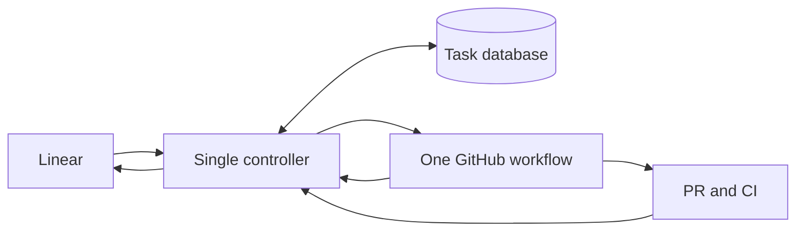

# One controller and one GitHub workflow

Date: 2026-10-30.

Status: implementation in progress. Production admission remains halted during
the rebuild. Implementation notes and dated evidence live in
[the controller topic](docs/remote-development-controller.md).

## Scope

Make two architectural changes:

1. One controller owns task decisions and task state.
2. One GitHub workflow orders the jobs within each normal task attempt.

Keep the existing Linear workflow, provider behavior, credential safeguards, and
GitHub runners. The work consolidates their coordination. It does not include a
provider/account-management redesign, a new workflow platform, or a separate
formal-verification project.



## 1. One controller owns task decisions

Replace independently advancing readiness, repository queue, lifecycle sync, and
repair logic with one controller. Other modules provide observations, perform
authorized operations, or display its committed state.

The controller owns:

- Queue eligibility, priority/manual ordering/FIFO policy, and dependencies.
- One active task per repository, retained through PR/CI/merge resolution.
- Readiness authorization and issue/repository-context invalidation.
- Task/attempt identity, permitted execution, existing bounded retry/repair policy,
  cancellation, and completion decisions.
- The task view used to update Linear, including holds and current run/PR links.

GitHub remains authoritative for actual job and PR facts. Agent results, job
conclusions, and task completion are distinct facts; a finish callback alone does
not release the repository or mark a task complete.

### Implementation

Run one trusted Python controller application on an Azure VM with a local SQLite
task database on a managed persistent disk. The broker is a module of this
application. Enforce one authorized controller host and one local mutation owner;
a local database lock alone does not exclude a cloned second host.

Expose a small interface:

```python
apply(command: Command) -> TaskView
inspect(task_id: TaskId) -> TaskView
```

Issue events, verified runner/PR observations, worker requests, and operator
commands cross this interface. They cannot directly set arbitrary lifecycle
states. Use one transition implementation and database transactions/constraints
for task identity, repository ownership, attempt records, and external-action
intent. Perform network calls outside database transactions so a slow API does
not block credential heartbeats.

Retain existing Azure account storage and broker-owned fenced leases. SQLite
transactions do not atomically include those leases. Check current task authority
before issuing new account/publication access; keep credential saves and releases
fenced. Credentials stay out of task records and Linear status.

### Work

- [ ] Inventory existing lifecycle writers and map their responsibilities to the
  controller. Preserve current product rules and authorization checks.
- [ ] Implement the task interface, transition logic, and transactional database.
- [ ] Route Linear events, GitHub observations, broker requests, steering, and
  status reporting through their assigned responsibilities.
- [ ] Test real database constraints, competing admission requests, duplicate/stale
  observations, readiness guards, completion evidence, and reporting independence.
- [ ] At a verified idle boundary, transfer necessary pending task references and
  queue order, disable the old lifecycle writers, and activate one new controller.
  Preserve account credentials, unresolved publication identities, and audit history.

Done when there is one lifecycle authority, one active task grant per repository,
and Linear reflects its decisions. No old module independently admits, retries,
repairs, or completes the same task. Valid tasks still progress automatically.

## 2. One GitHub workflow orders each task attempt

Replace the separate readiness and coding dispatches with one workflow graph:

```text
Review account preflight
          ↓
Read-only readiness review
          ↓
Coding account preflight
          ↓
Coding → validation → guarded PR publication
```

Use explicit job dependencies. Each preflight and agent job runs on a separate
fresh VM, preserving the existing credential isolation. A failed or non-passing
review cannot start coding. The broker verifies the actual passing readiness
result, current task grant, target context, and signed job identity; workflow
outputs alone cannot grant permission.

Scope account assignments by task, run, attempt, and review/coding phase. Give
phase-specific preflight/agent roles distinct signed reusable-workflow identities.
The current whole-run account binding cannot be reused unchanged for both phases.
A client-supplied phase cannot authorize a role, and a partial/manual rerun cannot
inherit another attempt's assignment or bypass a required stage.

GitHub owns job ordering. The controller dispatches the attempt once and observes
it; a review callback no longer triggers a second coding dispatch. Keep stable
attempt/action identities so duplicate events or an uncertain dispatch cannot
start another authorized worker.

After publication, the controller retains repository ownership while observing
PR checks and merge. No runner waits idle for human review or provider capacity.
Runtime files remain separate from the writable target checkout through actual
GitHub post-job cleanup.

### Work

- [ ] Build the combined workflow using pinned runtime references and explicit
  dependencies between the four jobs.
- [ ] Adapt broker authorization and account bindings to the phase-specific roles
  while preserving provider-selection, quota, sandbox, and publication safeguards.
- [ ] Remove the old readiness-completion-to-coding-dispatch path. Keep subsequent
  attempts permitted only by the controller's existing task policy.
- [ ] Test rejected readiness, wrong-phase requests, duplicate starts, partial
  reruns, separate account assignments, and preservation of runtime files.
- [ ] Run a real disposable task through readiness, both preflights, coding,
  validation, publication, CI/merge, credential release, post-job cleanup, and
  Linear completion using the ordinary guarded execution path.

Done when a normal task uses one workflow run, GitHub orders its jobs, the broker
preserves phase/account isolation, and the controller alone decides final task
completion and the next repository admission.

## Integration requirements

- **Fresh project code:** resolve the latest target branch when admitting the next
  task, including the previous task's merged changes. Bind readiness and coding
  to that context; a pinned runtime must not pin the target to an old checkout.
- **Automatic deployment:** retain automatic runtime testing, deployment, and
  verification between tasks. When required runtime code changes, admit the next
  issue only after that version is verified active. Ordinary project-only changes
  reach the next issue through its checkout without needing a runtime deployment.
- **Stable execution:** one attempt uses one runtime version. Deployment waits for
  existing work to drain; it clears only its own hold and preserves operator halts.
- **Acceptance:** run two sequential tasks and prove the second uses the first's
  merged code. Repeat with a runtime change and prove automatic deployment finishes
  before the second starts, without a routine manual step.

These are compatibility requirements for the two changes, not additional redesign
workstreams. Production admission remains halted while implementation and live
acceptance are outstanding; deployment cannot clear an independent operator halt.

Current behavior and safeguards are documented in
[the remote runtime](docs/remote-development.md),
[repository queues](docs/remote-development-queue.md), and
[account ownership](docs/remote-development-accounts.md). Update those owning
topics as the two changes ship.
